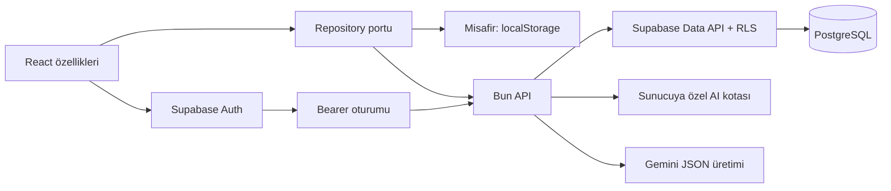

# Supabase ve Gemini bağlantısı

Bu aşamada kod ve yerel doğrulama hazırlanmıştır. Canlı Supabase projesine migration uygulanmamıştır; gerçek e-posta gönderimi ve ücretli Gemini çağrısı yapılmamıştır.

## Çalıştırma

Hesap bağlantısı olmadan uygulama mevcut misafir/localStorage modunda çalışır:

```sh
bun install
bun run dev
```

Hesap ve AI için örnek dosyaları kopyala:

```powershell
Copy-Item frontend/.env.example frontend/.env.local
Copy-Item backend/.env.example backend/.env
```

| Dosya | Değişken | Kullanım |
| --- | --- | --- |
| frontend/.env.local | VITE_SUPABASE_URL | Proje URL'si |
| frontend/.env.local | VITE_SUPABASE_PUBLISHABLE_KEY | Yalnızca tarayıcıya açık publishable key |
| frontend/.env.local | VITE_API_URL | Üretimde ayrı API origin'i; aynı origin ve geliştirme proxy'si için boş |
| backend/.env | SUPABASE_URL | Aynı Supabase projesi |
| backend/.env | SUPABASE_PUBLISHABLE_KEY | Kullanıcının Bearer token'ıyla çalışan normal veri istemcisi |
| backend/.env | SUPABASE_SECRET_KEY | Yalnızca sunucuda; kalıcı AI kotasını tüketen ayrı istemci |
| backend/.env | GEMINI_API_KEY | Yalnızca sunucuda |
| backend/.env | GEMINI_MODEL | Varsayılan gemini-3.8-flash; sunucudan değiştirilebilir |
| backend/.env | APP_ORIGINS | Virgülle ayrılan izinli uygulama origin'leri |
| backend/.env | HOST / PORT | Yerelde 127.0.0.1:3000; konteynerde HOST=0.0.0.0 |

```sh
bun run dev:api
bun run dev
```

Bun, backend çalışma dizinindeki .env dosyasını okur. Vite ayarı değişince frontend'i yeniden başlat. Gizli anahtarlar VITE_ ile tanımlanmaz ve tarayıcıya gönderilmez. Vite başlangıcı ve derleme, secret/service-role veya Gemini anahtarı taşıyan public ayarları reddeder. .env dosyaları ignore edilir. Önceki SQLite dosyaları korunur; yeni API bunları açmaz veya değiştirmez.

## Canlı projeye geçiş

Migration: supabase/migrations/20261110161008_atlas_cloud_foundation.sql.

CLI 3.1.0 projeye sabitlenmiştir. Komutlar yereli hedefler; bağlı canlı proje açıkça --remote ister. Sonraki bağlantı aşamasında:

```sh
bunx supabase login
bunx supabase link --project-ref PROJE_REFERANSI
bunx supabase db push --remote --dry-run
bunx supabase db push --remote
bunx supabase migration list --remote
bunx supabase db advisors --remote --type all --fail-on warn
```

Bu komutlar henüz çalıştırılmadı. Canlı işlem öncesi migration çıktısı ve hedef proje kontrol edilir. Docker kuruluysa yerel Supabase servisleri de kullanılabilir; mevcut testler Docker gerektirmez.

Auth için e-posta/şifre, kayıt, e-posta doğrulama, şifre sıfırlama ve çıkış kullanılır. Dashboard'da Email provider ve Confirm email açık olmalı; minimum şifre uzunluğu 10 olmalıdır. Site URL ve izinli Redirect URLs, uygulamanın gerçek adresi ve yerelde http://localhost:5173 / http://127.0.0.1:5173 ile eşleşmelidir. Üretim e-posta teslimi için SMTP ayrıca yapılandırılır. OAuth/anonim hesap açma bu aşamanın parçası değildir.

## Mimari sınırlar



- Frontend Supabase istemcisi yalnızca Auth içindir. Veri erişimi repository üzerinden Bun API'ye gider.
- Bun her korunan istekte token'ı Supabase getUser ile doğrular. x-user-id kabul edilmez. Kullanıcı verisi istemcisi publishable key + kullanıcının JWT'siyle çalışır; RLS atlanmaz.
- Ayrı secret-key istemcisi yalnızca consume_ai_quota RPC'sini çağırır. Anahtarı frontend'e verilmez.
- Ortak kelime/oyun/AI şemaları ve puan hesabı packages/shared/src altındadır. Backend JSX veya frontend alias'larına bağımlı değildir.
- Misafir verileri kendiliğinden hesaba aktarılmaz. Hesabım içinden açıkça aktarılabilir; tekrarlar mevcut kelimeleri değiştirmez. Hesapların tarayıcı önbellekleri kullanıcı ID'sine göre ayrılır.
- Bulut görevinde sonraki durum sunucu kaydı başarılı olduğunda gösterilir. Bağlantı hatasında cevap geçişi yapılmaz. Aynı görev iki sekmede değişirse revision çakışması bildirilir; yenileyerek sunucudaki son kayıt açılır.
- Sonuç kaydı görev ID'siyle idempotenttir. Kelime puanı, sonuç, günlük benzersiz kelimeler ve hedef günü tek SQL işlemiyle kaydedilir. Silinen kelimeler yeniden oluşturulmaz.
- Bu kişisel öğrenme ürününde kullanıcı kendi kelime puanını da düzenleyebilir. Puan hesabı sunucuda tekrarlanır; istemcideki cevapların sınav/yarışma düzeyinde güvenilir olduğu iddia edilmez.

## Tablolar ve yetkiler

| Tablo | İlişki ve erişim |
| --- | --- |
| profiles | auth.users ile 1:1; günlük hedef |
| words | auth.users ile 1:N; sahiplik, başlık, puan, kelime içeriği JSONB, zamanlar |
| learning_sessions | auth.users ile 1:N; sürümlü snapshot, revision ve tamamlanma zamanı |
| learning_results | learning_sessions ile 1:1; kullanıcı + oturum birleşik FK, değişmez sonuç kaydı |
| daily_word_completions | kullanıcı + İstanbul günü + kelime ID'si benzersiz; kelime silinince tarihçe kalır |
| completed_goal_days | kullanıcı + gün benzersiz; gerçekleşen günlük hedef kalıcıdır |
| ai_usage | kullanıcı + zaman kovası; yalnızca service_role erişir |

Yedi tabloda da RLS açıktır. Kullanıcı politikaları TO authenticated ile (select auth.uid()) = user_id koşulunu birlikte kullanır. Yazılabilir sahiplik alanlarında WITH CHECK vardır. anon için tablo ve uygulama fonksiyonu yetkisi verilmez. Fonksiyonlar SECURITY INVOKER ve boş search_path kullanır; PUBLIC execute yetkisi kaldırılır ve gereken rol açıkça yetkilendirilir.

words içinde lower/boşluk normalize edilmiş kullanıcı başına benzersiz indeks vardır. Sahiplik/tarih ve yabancı anahtar sorguları için indeksler eklenmiştir. İçeriğin örnek/çeviri/vurgu alanları JSONB'de kalır; score ve word ayrı sütunlardan okunur. Grup güncel puandan türetilir, ikinci kez saklanmaz.

## API

/health dışındaki uçlar Authorization: Bearer ile korunur.

| Yöntem | Yol | İşlem |
| --- | --- | --- |
| GET | /api/health | Yapılandırma durumunu anahtar göstermeden döndürür |
| GET | /api/account | Hedef, son görev ve günlük tarihçe |
| PUT | /api/account/goal | Günlük hedef; tamamlanmış günü korur |
| GET / POST | /api/words | Liste / tekli ekleme |
| PUT / DELETE | /api/words/:id | Düzenleme / silme |
| POST | /api/words/import | Atomik, tekrarları atlayan toplu ekleme |
| DELETE | /api/words/bulk | Toplu silme |
| PUT | /api/words/scores | Kullanıcının mutlak puan güncellemeleri |
| PUT | /api/learning/session | Beklenen revision ile oturum kaydı |
| POST | /api/learning/sessions/:id/complete | Sunucuda hesaplama ve atomik sonuç kaydı |
| POST | /api/ai/words/enrich | Gemini önerisi; kendiliğinden kaydetmez |

Hatalar error, code ve requestId alanları taşır. SQL/provider hataları ve anahtarlar yanıta yazılmaz. Loglar requestId/kod/durum içerir. Origin izin listesi, JSON gövde sınırı, Zod doğrulaması, zaman aşımı ve no-store uygulanır. Liste ve tarihçe, Supabase'in satır sınırında sessizce kesilmemesi için sayfalanır.

## Gemini akışı

Kelime formundaki “Öneri oluştur” yalnızca İngilizce başlığı gönderir. Sunucu doğrular, kalıcı kotayı tüketir ve JSON Schema ile anlam/kullanım notu/tür/CEFR/beş özgün örnek ve çevirisini ister. Sağlayıcı yanıtı tekrar Zod ile doğrulanır; başlık eşleşmesi, İngilizce cümlede odak kelimenin bulunması ve Türkçe vurgu parçalarının çeviri içinde bulunması kontrol edilir.

Kullanıcı öneriyi inceler, “İnceledim, öneriyi forma aktar” ile formu doldurur ve ayrıca kaydeder. Mevcut puan ve kullanıcı URL/ses alanları korunur. Örneklerin Gemini kaynak bilgisi ve Türkçe odak parçaları saklanır. AI önerileri doğrulanmış sözlük verisi olarak sunulmaz; başlangıç seti editoryal içerik olarak kalır.

Kota: kullanıcı başına dakikada 5, UTC gününde 40 çağrı; eşzamanlı talepler PostgreSQL satır kilidiyle sayılır. Başarısız sağlayıcı çağrıları da kotadan tüketir. Gemini zaman aşımı 30 saniyedir. Sağlayıcı/model değişkeni istemciden alınmaz. Otomatik ücretli tekrar veya tarayıcıdan Gemini çağrısı yapılmaz.

## Doğrulama kapsamı

```sh
bun run format:check
bun run lint
bun run build
bun run test
bun run test:e2e
bun run test:cloud
bun run test:dev
```

- Birim testleri: oyun/regresyon, hesap önbelleği ayrımı ve sıralı bulut kayıtları.
- API testleri: Supabase doğrulanmış kullanıcı, sahte token, başlıkla kimlik taklidi, doğrulama, Origin, kota, zaman aşımı ve Gemini içerik sınırları.
- PostgreSQL testleri: PGlite üzerinde migration gerçekten yürütülür; ayrı roller/kullanıcılarla RLS, sahipliği değiştirme, transaction rollback, revision çakışması ve tekrarlı sonuç kaydı sınanır.
- Tarayıcı testleri: masaüstü/mobil yerel kullanım; ayrı yapılandırılmış sunucuda Auth/Bun/Gemini HTTP sözleşmeleri mock edilerek giriş/yenileme/çıkış/ikinci hesap, AI önizleme ve bulut sonucu kontrol edilir.
- Canlı Supabase advisor, Auth e-posta/SMTP ve gerçek Gemini sağlayıcı doğrulaması proje bağlandıktan sonra yapılır. PGlite Supabase Auth veya PostgREST sunucusu değildir.

Kaynaklar: [Supabase React Auth](https://supabase.com/docs/guides/auth/quickstarts/react), [RLS](https://supabase.com/docs/guides/database/postgres/row-level-security), [Data API grant değişikliği](https://supabase.com/changelog/45329-breaking-change-tables-not-exposed-to-data-and-graphql-api-automatically), [Gemini generateContent](https://ai.google.dev/api/generate-content?hl=en), [Gemini 3.8 Flash](https://aistudio.google.com/docs/models/gemini-3.8-flash).


